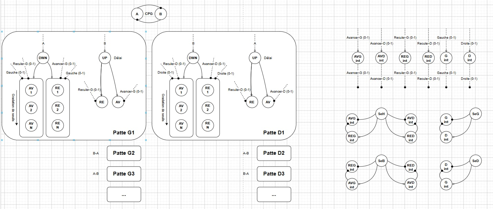

# Hexapode piloté par un réseau de neurones impulsionnels (Brian2)

Simulation d'un robot à pattes (hexapode par défaut, jusqu'à 200 pattes) dont la marche est
entièrement produite par un réseau de neurones bio-inspiré écrit avec
[Brian2](https://brian2.readthedocs.io). Un générateur de rythme (CPG) cadence une marche en
tripode. Des interneurones inhibiteurs gradués traduisent les commandes (avancer, reculer,
tourner) en nombre de motoneurones recrutés. Des capteurs de distance ajoutent des réflexes
d'évitement d'obstacles.

On peut piloter le robot en direct à la manette (Xbox) ou au clavier, dans une vue de dessus
qui affiche le corps, les pattes, les obstacles et les capteurs.

Le projet est uniquement en simulation (pas de matériel).

---

## Sommaire

1. [Installation](#installation)
2. [Lancer le projet](#lancer-le-projet)
3. [Organisation des fichiers](#organisation-des-fichiers)
4. [Le réseau de neurones](#le-réseau-de-neurones)
5. [Le code non neuronal et ses interactions avec le réseau](#le-code-non-neuronal-et-ses-interactions-avec-le-réseau)
6. [Chronologie d'un demi-cycle](#chronologie-dun-demi-cycle)
7. [Paramètres principaux](#paramètres-principaux)
8. [Tests](#tests)
9. [Limites connues et pistes](#limites-connues-et-pistes)

---

## Installation

Environnement conda (testé sous Windows) :

```bash
conda create -n brian2_env -c conda-forge brian2 matplotlib pillow
conda activate brian2_env
pip install pygame        # optionnel : seulement pour la manette
```

Sans `pygame`, le mode manuel fonctionne au clavier uniquement.

## Lancer le projet

### Pilotage en direct

```bash
python manual.py
```

Une fenêtre matplotlib s'ouvre (cliquer une fois dessus pour qu'elle reçoive le clavier).

| Commande | Manette (Xbox) | Clavier |
|---|---|---|
| Avancer / reculer | stick gauche haut / bas (proportionnel) | ↑ / ↓ |
| Tourner en marchant | stick droit gauche / droite (proportionnel) | ↑ ou ↓ + ← / → |
| Tourner sur place | croix gauche / droite | ← / → seules |
| Quitter | Start | Échap ou fermer la fenêtre |

À l'écran :
- **Pattes :** tripode A en bleu, tripode B en rouge. Pied plein : au sol ; pied creux : levé.
- **Capteurs :** rayons du vert (loin) au rouge (proche).
- **Obstacles :** en gris.
- **Corps :** devient rouge s'il chevauche un obstacle. Le corps traverse les obstacles ; le chevauchement est seulement signalé.

Le mode manuel nécessite une vraie fenêtre (terminal ou bouton « Run » de VS Code). La
fenêtre interactive de type Jupyter ne reçoit pas les touches.

### Tests scriptés

```bash
python main.py
```

Par défaut, `main.py` lance `test_sensors()`. Les autres tests sont en commentaire dans le
bloc `if __name__ == '__main__':` (voir [Tests](#tests)). Les figures et animations sont
enregistrées dans le dossier `graphs/` (`*.png`, `*.gif`).

## Organisation des fichiers

| Fichier | Rôle |
|---|---|
| `config.py` | Paramètres globaux : pattes, rythme, délais, géométrie du corps, capteurs |
| `CPG.py` | Générateur de rythme : 2 neurones, un potentiel d'action par demi-cycle |
| `legs.py` | Motoneurones des pattes (R, D, groupes F et B) et excitation par le CPG |
| `intermediates.py` | Les 6 interneurones gradués inhibiteurs entre le cerveau et les pattes |
| `sensors.py` | Les 6 capteurs de distance (neurones gradués) et leurs synapses vers les intermédiaires |
| `brain.py` | Le « cerveau » : code classique qui traduit (vitesse, virage) en entrées des intermédiaires |
| `body.py` | Cinématique du corps (vue de dessus) et des pattes dessinées, à partir des potentiels d'action |
| `world.py` | Arène (murs) et obstacles rectangulaires fixes, lancer de rayons |
| `robot.py` | La boucle fermée complète : réseau + corps + monde + capteurs |
| `manual.py` | Pilotage en direct (manette / clavier), affichage temps réel |
| `visualisation.py` | Toutes les figures et animations (les classes de simulation n'en contiennent pas) |
| `main.py` | Tests scriptés avec vérifications automatiques |
| `graphs/` | Figures et animations générées, et `Graph_neurons.jpg` (schéma du réseau) |

## Le réseau de neurones



Correspondance entre les noms du schéma et ceux du code :

| Schéma | Code |
|---|---|
| AV 1..N / RE 1..N | groupes F (avant) / B (arrière) d'une patte |
| UP / DWN | R (lever) / D (poser) |
| AVG, AVD, REG, RED int | I-Fwd-L, I-Fwd-R, I-Rev-L, I-Rev-R |
| G, D int | I-Steer-L, I-Steer-R |
| SeH, SeB, SeG, SeD | capteurs avant (FL, FR), arrière (RL, RR), côtés (SL, SR) |

Vue d'ensemble :

```
            CODE CLASSIQUE                          RÉSEAU (Brian2)
  ┌───────────────────────────────┐
  │ Manette / clavier / scénario  │
  │      (vitesse, virage)        │
  └──────────────┬────────────────┘
                 ▼  à chaque demi-cycle
  ┌───────────────────────────────┐   écrit `brain`, `gate`
  │ Brain (code classique)        │ ─────────────────────────┐
  └───────────────────────────────┘                          ▼
                                       ┌──────────────────────────────────────┐
     ┌──────────────┐  déclenchement   │ 6 INTERMÉDIAIRES (gradués, inhib.)   │
     │ CPG          │ ───────────────► │ I-Fwd-G/D  I-Rev-G/D  I-Steer-G/D    │
     │ A ──T/2──► B │  (phase d'appui) │ level = clip(brain + gate·sensor,0,1)│
     │ (pacemaker)  │                  └───────────────┬──────────────────────┘
     └──────┬───────┘                                  │ inhibition level·N
            │ excitation (EXC_DELAY)                   │ (arrive avant)
            ▼                                          ▼
     ┌─────────────────────────────────────────────────────────────┐
     │ MOTONEURONES, par patte :  R   D   F0..F(N-1)  B0..B(N-1)   │
     │ LIF, seuils (k+½)u  → nombre recruté = N − inhibition       │
     └──────────────────────────────┬──────────────────────────────┘
                                    │ potentiels d'action (SpikeMonitor)
                                    ▼
  ┌───────────────────────────────────────────────┐
  │ Robot.odometry → Body (pose, pattes)          │
  │ World : lancer de rayons à la pose courante   │
  └──────────────────────┬────────────────────────┘
                         │ écrit `distance`
                         ▼
                 ┌───────────────────────────────┐   synapses sommées
                 │ 6 CAPTEURS (neurones gradués) │ ──────────► intermédiaires
                 │ FL FR RL RR SL SR : near,close│      (entrée `sensor`)
                 └───────────────────────────────┘
```

### 1. CPG : le rythme (2 neurones LIF)

- **A** est un pacemaker : un courant constant le fait décharger exactement toutes les 500 ms
  (dès t = 0).
- **B** est un relais : une synapse A → B retardée d'une demi-période le fait décharger
  250 ms après A.
- On obtient **un potentiel d'action par demi-cycle**, alternativement A puis B.

Chaque patte a une **phase** = (rang + côté) mod 2. Cela forme deux tripodes : quand les
pattes de phase A sont en appui, celles de phase B sont en vol, puis on alterne.

### 2. Motoneurones des pattes (par patte : R, D, N × F, N × B)

Neurones LIF (τ = 20 ms) dont les **seuils sont régulièrement espacés** :
θ_k = (k + ½)·u avec u = 1 mV. Une entrée de m·u atteint donc exactement les m seuils les
plus bas.

| Neurone | Excité par | EPSP | Freiné par |
|---|---|---|---|
| **D** (poser) | le neurone CPG de sa phase d'appui | N·u | rien : chaque début d'appui pose le pied |
| **R** (lever) | l'autre neurone CPG, + délai de levée de 10 ms | 2N·u | I-Fwd et I-Rev de son côté |
| **F**, **B** | les deux neurones CPG | N·u | les intermédiaires de direction et de virage |

Sans inhibition, les N neurones F et les N neurones B déchargent tous. **Le nombre de
neurones qui déchargent est l'amplitude du pas** : N moins l'inhibition, les seuils les plus
bas d'abord.

L'inhibition est libérée au potentiel d'action du CPG. Elle arrive avant l'excitation, qui
est retardée de `EXC_DELAY` = 2 ms. Les poids compensent exactement la fuite de la membrane
pendant ce délai.

Le délai de levée (R + 10 ms) fait que le tripode en vol ne se lève qu'une fois l'autre
tripode posé.

### 3. Intermédiaires : 6 neurones gradués inhibiteurs

Ils ne déchargent pas. Leur activité est un niveau de « frein » entre 0 et 1 :

```
level = clip(brain + gate · sensor, 0, 1)
```

- `brain` : entrée du cerveau (code classique).
- `sensor` : somme des entrées des capteurs.
- `gate` : porte posée par le cerveau ; les capteurs n'agissent que pendant la marche.

À chaque potentiel d'action du CPG, une synapse de déclenchement leur indique quel tripode
est en appui. Un pas de temps plus tard, chacun libère une inhibition de `level · N` sur son
côté :

| Intermédiaire | Pattes en appui | Pattes en vol | Aussi |
|---|---|---|---|
| **I-Fwd-X** (avancer) | freine F (poussée avant) | freine B (retour) | R |
| **I-Rev-X** (reculer) | freine B (poussée arrière) | freine F (retour) | R |
| **I-Steer-X** (virage) | freine F et B | freine F et B | – |

Exemple, marche avant à la vitesse s : I-Fwd = 1 − s et I-Rev = 1.
- **En appui :** s·N neurones F déchargent (poussée).
- **En vol :** s·N neurones B déchargent ; le retour est le miroir de la poussée.
- **Levée :** R reçoit 2N − (1 − s)N − N = s·N > 0, donc la patte se lève dès que s > 0.

Le virage est multiplicatif : l'amplitude d'un côté vaut s·(1 − virage de ce côté).

### 4. Capteurs : 6 neurones gradués

Chaque capteur est une ligne de visée 1D. Sa distance mesurée est convertie en deux
activités :

```
near  = clip((portée − distance) / (portée − marge), 0, 1)   # 0 hors portée, 1 au contact
close = clip((0.2 − distance) / 0.02, 0, 1)                  # zone de recul
```

Ils sont reliés aux intermédiaires par une synapse sommée sur l'entrée `sensor` :

| Capteur | Position | Portée | I-Fwd-G/D | I-Rev-G/D | I-Steer |
|---|---|---|---|---|---|
| FL, FR | nez, ±20° | 0,6 m | near/2 + close | − close | tourne à l'opposé (FL − FR) |
| RL, RR | coins arrière, ±160° | 0,4 m | − close | near/2 + close | – |
| SL, SR | milieu des flancs, ±90° | 0,3 m | – | – | tourne à l'opposé (SL − SR) |

- **Obstacle devant (derrière) :** freine progressivement la marche avant (arrière). Un mur
  droit devant est vu par les deux capteurs, chacun donne la moitié du frein.
- **Plus près que 0,2 m (réflexe de recul) :** la direction vers l'obstacle est freinée
  complètement, et la direction opposée est **désinhibée** (le capteur inhibe
  l'intermédiaire opposé). Le robot s'éloigne jusqu'à sortir de la zone, puis la commande du
  pilote reprend la main : cela produit un va-et-vient (« yoyo ») tant que le pilote pousse
  vers l'obstacle.
- **Obstacle vu plus d'un côté :** l'autre côté est freiné, le robot tourne à l'opposé.
  C'est la différence gauche − droite qui compte : un mur droit devant ne fait que freiner,
  et dans un couloir les deux flancs s'annulent, donc le robot se centre.
- **Arrêt ou rotation sur place :** les capteurs sont coupés (`gate = 0`) et ne déplacent
  jamais le robot.

## Le code non neuronal et ses interactions avec le réseau

Le code classique ne touche le réseau que de trois façons :
- il **écrit des variables de neurones** (`brain`, `gate`, `distance`) ;
- il **lit les potentiels d'action** (`SpikeMonitor`) ;
- il s'exécute sous forme de **`network_operation` Brian2**, des fonctions Python appelées à
  instants fixes pendant la simulation.

| Code | Quand | Lit | Écrit / fait |
|---|---|---|---|
| **Manette / clavier / scénario** (`manual.py`, `main.py`) | à la demande | touches, sticks, scénario | (vitesse, virage) |
| **Brain** (`brain.py`) | début de chaque demi-cycle, juste avant le potentiel d'action du CPG | (vitesse, virage) | `brain` des 6 intermédiaires (motif « stop » par défaut), `gate` = 1 seulement en marche |
| **Odométrie** (`robot.py`) | toutes les 10 ms ; agit quand les potentiels d'action d'un demi-cycle sont arrivés (~13 ms après le CPG) | potentiels d'action des motoneurones | `Body` : F − B des pattes en appui → poussée du corps (comme un char) ; R / D → pieds levés / posés |
| **Capteurs** (`sensors.py`, `world.py`) | toutes les 10 ms | pose courante, monde | lancer de rayons → `distance` des 6 neurones capteurs |
| **Affichage** (`manual.py`, `visualisation.py`) | 20 images/s | pose, pattes, rayons | dessin et synchronisation temps réel |

**La boucle fermée :** commande → cerveau → intermédiaires → motoneurones → pose du corps →
monde → capteurs → intermédiaires.

En résumé :
- le **cerveau** décide *quoi faire* ;
- le **CPG** décide *quand* ;
- les **intermédiaires** traduisent des commandes graduées en *combien* de motoneurones
  recrutés ;
- les **capteurs** ne peuvent passer outre le cerveau qu'à travers ces mêmes intermédiaires.

**Mouvement du corps :** chaque neurone F (B) déchargé par une patte en appui pousse le corps
de `STRIDE / N` vers l'avant (l'arrière). Chaque côté avance de la poussée moyenne de ses
pattes en appui. Le corps avance de la moyenne des deux côtés et tourne de leur différence
divisée par l'écartement des pieds. Le vol ne déplace pas le corps.

## Chronologie d'un demi-cycle

| Temps après le potentiel d'action du CPG | Événement |
|---|---|
| 0 (même pas de temps, juste avant) | le cerveau verrouille la commande : `brain` et `gate` sont posés |
| 0 | potentiel d'action du CPG ; les intermédiaires apprennent quel tripode est en appui |
| + 0,5 ms | les intermédiaires libèrent leur inhibition (level·N) |
| + 2 ms | l'excitation du CPG atteint F, B, D : les neurones non freinés déchargent (poussée, retour, pose) |
| + 12 ms | R décharge : le tripode en vol se lève, une fois l'autre posé |
| ≈ + 13 ms | l'odométrie compte les potentiels d'action ; le corps avance de cette poussée, répartie sur le demi-cycle |
| 0 à 250 ms | les capteurs sont mis à jour toutes les 10 ms ; leur effet s'applique au potentiel d'action suivant du CPG |

Conséquence : entre une commande et le mouvement, il s'écoule 0 à ¼ s (attente du prochain
potentiel d'action du CPG).

## Paramètres principaux

Tous dans `config.py` :

| Paramètre | Valeur | Rôle |
|---|---|---|
| `N_LEGS` | 6 | nombre de pattes (pair, de 6 à 200) ; l'affichage montre toujours 6 pattes |
| `N_MOTOR` | 10 | neurones par groupe F / B (résolution de l'amplitude) |
| `CYCLE_PERIOD` | 500 ms | période du CPG (rythme fixe) |
| `TAU_M` | 20 ms | constante de temps des motoneurones (≤ période / 20) |
| `EXC_DELAY` | 2 ms | délai CPG → motoneurones (l'inhibition arrive avant) |
| `LIFT_DELAY` | 10 ms | retard de la levée (R) |
| `BODY_LENGTH`, `BODY_WIDTH` | 0,30 m, 0,15 m | dimensions du corps |
| `TRACK_WIDTH` | 0,25 m | écartement gauche-droite des pieds |
| `STRIDE` | 0,06 m | déplacement pour une poussée complète (N neurones) → 24 cm/s à pleine vitesse |
| `ARENA_SIZE` | 4 m | arène carrée |
| `FRONT_RANGE`, `REAR_RANGE`, `SIDE_RANGE` | 0,6 / 0,4 / 0,3 m | portées des capteurs |
| `CONTACT_MARGIN` | 0,05 m | distance où le frein est complet |
| `BACKOFF_DISTANCE`, `BACKOFF_RAMP` | 0,2 m, 0,02 m | zone de recul |
| `STEER_GAIN`, `SIDE_STEER_GAIN` | 1,0 | force d'évitement (capteurs avant / latéraux) |
| `SENSE_DT` | 10 ms | période de mise à jour capteurs / odométrie |

Réglages de pilotage, en tête de `manual.py` :

| Paramètre | Valeur | Rôle |
|---|---|---|
| `KEY_STEER` | 0,5 | virage au clavier |
| `KEY_SPIN` | 1,0 | rotation sur place |
| `PAD_MAX_STEER` | 0,8 | virage maximal à la manette (les pattes intérieures gardent 20 %, virage serré sans pivot) |
| `STICK_DEADZONE` | 0,15 | zone morte des sticks |

Le monde par défaut (`DEFAULT_OBSTACLES` dans `world.py`) contient un bloc droit devant le
départ et deux blocs formant un couloir de 0,5 m.

## Tests

Fonctions de `main.py`, chacune avec vérifications automatiques :

| Test | Vérifie | Sorties |
|---|---|---|
| `test_cpg()` | période exacte de 500 ms et décalage de 250 ms entre A et B | `cpg_test.png` |
| `test_legs()` | recrutement N − m sous une inhibition de test, plus bas seuils d'abord, R/D | `legs_test.png` |
| `test_control()` | réseau complet sur un scénario de 8 s : nombre exact de R, D, F, B par patte et par demi-cycle (marche avant, demi-vitesse, virages, arrêt, recul, rotation sur place) | `control_test.png` |
| `test_body()` | idem, plus la trajectoire du corps | `body_trajectory.png`, `body_animation.gif` |
| `test_sensors()` | réflexes en boucle fermée (voir ci-dessous) | `sensors_wall.png`, `sensors_wall.gif` |

`test_sensors()` couvre cinq scénarios :
1. Mur devant, marche avant : yoyo sans contact.
2. Mur derrière, marche arrière : yoyo sans contact.
3. Rotation sur place près d'un mur : identique à la même rotation sans mur.
4. Arrêt dans la zone de recul : aucun mouvement.
5. Couloir, départ décentré de 8 cm : le robot se centre sans contact.

`test_control()` fonctionne aussi avec 200 pattes et N = 50 :
`test_control(n_legs=200, n_motor=50)`.

## Limites connues et pistes

- **Latence :** une commande attend jusqu'à un demi-cycle (¼ s) le prochain potentiel
  d'action du CPG. Un CPG plus rapide la réduirait, avec ces contraintes :
  - `TAU_M ≤ période / 20` ;
  - `EXC_DELAY + LIFT_DELAY < période / 2` ;
  - la vitesse de marche double si la période est divisée par deux (à `STRIDE` constant).
- **Virage pendant le recul :** le virage n'est pas sensible à la direction. Pendant un
  recul réflexe, le freinage d'évitement des capteurs avant ramène le nez vers l'obstacle
  (accepté pour l'instant).
- **Réflexes de recul :** ils agissent dans les deux sens de marche. Marcher lentement en
  avant avec un obstacle très proche derrière accélère le robot jusqu'à sortir de la zone.
- **Yoyo à basse vitesse :** à vitesse réduite, le frein progressif arrête le robot avant la
  zone de recul, donc il n'y a pas de yoyo.
- **Collisions :** pas de physique de collision, le corps traverse les obstacles
  (chevauchement affiché en rouge).
